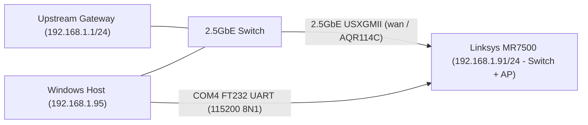

# Linksys MR7500 (Hydra Pro 6E) OpenWrt + NSS Porting Skill

This skill documents the current hardware topology, active dual-slot firmware baseline, Device Tree and kernel patch stack (`0001`–`0006`), triple-read backup verification, 3-boot persistent crash logging, session lessons learned, and test workflows for the **Linksys MR7500 v1 (codename `divo`)**.

> [!CAUTION]
> ### DISCLAIMER & LIMITATION OF LIABILITY
> **The author(s), contributors, and maintainers of this repository are NOT responsible for any bricked devices, damaged hardware, bootloops, destroyed flash partitions, lost calibration data, data loss, fire, voided warranties, or any other damages or failures resulting from using, compiling, flashing, or modifying the code, device trees, patches, configurations, or instructions provided here.**
> Always maintain verified backups of all MTD partitions (especially `0:ART` and `devinfo`) before flashing. **PROCEED STRICTLY AT YOUR OWN RISK.**

> [!NOTE]
> ### LLM / AI-ASSISTED DEVELOPMENT NOTICE
> This repository's patches, DTS adjustments, reverse engineering analyses, automation scripts, and documentation were developed with AI coding assistants and empirically verified on physical MR7500 hardware via UART telemetry, `phytool`/`ethtool`, `iperf3`, and LuCI `/ubus` regression tests.

---

## 1. Environment & Access Topology (Post-VM Migration, 2026-11-17)



* **Primary Windows Workspace (`192.168.1.95`):**
  * **Git Repo Clone:** `Linksys-MR7500-NSS/` (`origin git@github.com:SanjayRavindran/Linksys-MR7500-NSS.git`, branch `master`, synced at `1fcb877+`).
  * **Nov 15 Dual-Profile Builds:** `bin/router-mode/` (`10.143.1.1/24`) and `bin/switch-ap-mode/` (`192.168.1.91/24`), plus `bin/flash_mr7500_tftp_ubuntu.sh` (`Nov 11` archive in `bin/archive_20261111/`).
  * **Verified NAND Backups:** `backups/pass1/`, `pass2/`, `pass3/`, `source_of_truth/`, `critical_and_fallback_bundle.tar.gz`, `live_router_snapshot_20261117/`, and `SHA256_VERIFICATION_REPORT.txt`.
  * **Stock Blobs & REA:** `blobs/`, `stock_extract/`, `stock_nss_11_5_fallback/`, `rea_mr7500_out/`, and retired `.87` Ubuntu VM archive `vm_archive_87/` (contains `.ssh/id_ed25519`, `.gitconfig`, `openwrt-ipq/.config`, `feeds.conf.default`, `fw/FW_MR7500_1.1.12.216943_prod.img`, and non-MR7500 project backups).
  * **Router UART (`COM4`):** FT232 USB-UART at `115200 8N1`, driven via `tools/uart.py`.
  * **Retired Ubuntu Build VM (`.87`):** Archived on `2026-11-17` and marked for deletion. Future Linux builds run via GitHub Actions (`.github/workflows/build-monthly-snapshot.yml`) or any fresh Ubuntu 24.04/26.04 host with `scripts/build.sh --profile all`. Do not call `tools/vm_exec.py` once `.87` is removed.
* **Live MR7500 Router (`192.168.1.91`, Switch + AP Mode):**
  * **SSH / LuCI / Serial:** User `root`, password via `MR7500_ROUTER_PW` env var (or prompt/local test fallback); direct Paramiko SSH from Windows works cleanly without `.87`.
  * **Active Dual Slots:** Both **Slot 1 (`boot_part=1`)** and **Slot 2 (`boot_part=2`, currently active)** run the Nov 15 **OpenWrt `6.12.92` + NSS `12.5`** Switch+AP image (all Patches `0001`–`0006` + `mr7500-irq-tune` + `mr7500-persist-log`).

---

## 2. Hardware & Firmware Baseline

Detailed partition layout, DTS/kernel patches, and peripheral notes are in [references/hardware-and-dts-audit.md](./references/hardware-and-dts-audit.md) and [Architecture & Experience Charts](../../../docs/ARCHITECTURE_AND_EXPERIENCE_LOG.md).

* **SoC / RAM / Flash:** Qualcomm IPQ6018 (4x ARM Cortex-A53 @ 1.8 GHz, `performance`), 512 MB DDR3L (`386,492 kB` Linux usable, `extra_pbuf_core0=3100672`), 512 MB Hynix `H27S4G8F2EDA-BC` SLC NAND (`erasesize=0x20000`, `0` bad PEBs).
* **5GbE WAN Port (`dp5-syn` / `wan`):** Marvell/Aquantia `AQR114C-B0` (`MDIO 8`, C45 `USXGMII`), loads `/lib/firmware/marvell/AQR114C.cld` (`v5.6.5 Cybertan Divo`, SHA-256 `32bc96c20351d7981d2d905b843899834e6dd620844218d6f3e1ecb9691745f3`). Links at **2500 Mb/s Full** (`4/0xc441=0x0008`, `4/0xe812=0xb419`) across cold boot and hotplug (Patches `0001`–`0005`), HW LEDs `offloaded=1/1`, **2.32/2.37 Gbps** bidirectional TCP verified.
* **Switch Fabric & Switch+AP Bridge:** QCA8075 (`lan1`..`lan4` over `QSGMII`, `IPGT=0x70`) + `wan` (`dp5-syn`) + `phy0-ap0`/`phy1-ap0`/`phy2-ap0` bridged in `br-lan` (`192.168.1.91/24`, DHCP disabled).
* **Tri-Band Wi-Fi 6E:**
  * `phy1` (2.4G QCN5022, `ath11k_ahb`): `Linksys-MR7500-2.4G` (`HE40`, Ch 6)
  * `phy0` (5G QCN5052, `ath11k_ahb`): `Linksys-MR7500-5G` (`HE80`, Ch 36)
  * `phy2` (6G QCN9074 PCIe `0000:01:00.0`, `ath11k_pci`): `Linksys-MR7500-6G` (`HE160`, Ch 37, OWE)
  * Host path (`ath11k nss_offload=0 frame_mode=0`) avoids `qca-nss-wifili` RX buffer starvation; `ce_irq_lock` spinlock (Patch `0006`) + `GIC-0 ce[0-9]` CPU 1 affinity prevent edge-IRQ freezes.
* **Peripherals & Logs:** DWC3 xHCI USB 3.0 active (`GPIO 25` VBUS), CSR8811 BLE held in reset (`GPIO 34`), 7x TSENS (~68–69°C), `/dev/watchdog0`, and 3-boot persistent logger in `/root/boot-logs/` (`boot-0..3.log` + `.diag`).

---

## 3. Patch Stack (`0001`–`0006`) & Rootfs Overlays

| Patch / Service | Summary |
|---|---|
| `0001-qualcommax-ipq6018-mr7500-add-complete-nss-offload.patch` | Complete NSS 12.5 DTS, AQR114C reset timing, USB host, C45 MDIO probe wait (`0982`) |
| `0002-qualcommax-ipq6018-mr7500-enable-usxgmii-inband-status.patch` | Enables USXGMII `managed = "in-band-status"` on `&dp5_syn` |
| `0003-qualcommax-mr7500-fix-usxgmii-probe-race-and-wan-leds.patch` | PHY probe/attach serialization (`0984`), netdev LED Oops guard (`0985`), `0983` USXGMII AN, `green:wan` LEDs |
| `0004-qualcommax-mr7500-optimize-pbuf-ipgt-and-cleanup-dts.patch` | `qca-nss-pbuf` `nss_offload=0` bypass, SSDK `IPGT=0x70` (`002`), `bt_reset_hog`, drops dead `nss_macsec0` |
| `0005-qualcommax-mr7500-harden-aqr114c-usxgmii-hotplug.patch` | `aqr_wait_fw_provisioning()` + `aqr_enable_usxgmii_autoneg()` across boot, resume, `aneg`, and hotplug |
| `0006-qualcommax-mr7500-serialize-ath11k-ahb-ce-irq.patch` | `990-wifi-ath11k-ahb-serialize-ce-irq-enable-disable.patch` (`ce_irq_lock` via `spin_lock_irqsave`) |
| `files/etc/init.d/mr7500-irq-tune` | Pins `GIC-0 ce[0-9]` onto CPU 1 (`2`); spreads `nss_queue0..3`, `empty_buf_*`, DP/PCIe MSIs off CPU 0 |
| `files/etc/init.d/mr7500-persist-log` + `mr7500-log-watch` | Unbuffered `logread -f -l 9999 -t -F` (`fsync` per line) + 30s health/D-state/dmesg crash watcher (3-boot rotation) |

---

## 4. Verification & Test Commands

See [references/test-cases.md](./references/test-cases.md) for the full matrix (`20/20` CI gates, `15/15` artifact gates, `14/14` live hardware regression tests).

* **Live Router 14-Point Suite (directly from Windows):**
  ```powershell
  python tests/test_mr7500_validation.py --host 192.168.1.91 --user root
  ```
* **CI Pre-Build Suite (on Ubuntu / CI runner):**
  ```bash
  bash scripts/ci_test.sh
  ```
* **Inspect Persistent Boot / Crash Logs on Router:**
  ```sh
  tail -f /root/boot-logs/current.log
  cat /root/boot-logs/boot-1.log /root/boot-logs/boot-1.diag
  ```

---

## 5. Critical Session Lessons & Guardrails (Do Not Regress)

1. **AQR114C NVMEM Guard:** Never re-add `nvmem-cells = <&aqr_fw>` to DTS — `mtd9` holds OEM `v5.4.B`, so Linux must always load `/lib/firmware/marvell/AQR114C.cld` (`v5.6.5`).
2. **Never Lock `ab->base_lock` Inside Hard IRQ:** `ath11k_ahb_ce_interrupt_handler()` runs in hard IRQ context while `ab->base_lock` uses `spin_lock_bh`; use dedicated `ce_irq_lock` with `spin_lock_irqsave`. Keep all `GIC-0 ce[0-9]` on CPU 1.
3. **Never Run `/sbin/logd -h` on a Live Router:** It clobbers `/dev/log` socket ownership/inode before exiting and breaks `logger` until `/etc/init.d/log restart`.
4. **Always Pass `-l 9999` with `logread -f`:** Otherwise `logread -f` sends `lines=0` to `logd` and skips all boot `kmsg` lines.
5. **Dropbear / Paramiko Quirks:** OpenWrt Dropbear lacks `sftp-server` (stream via `cat > file` stdin or `tar -cf -` stdout), and drops connections on literal `\0` NUL bytes inside `exec_command` strings.
6. **Sysupgrade Rules:** Validate with `sysupgrade -T /tmp/fw.bin` first; never pass `-n` on a live Switch+AP unit unless wiping config; keep custom init/watch scripts in `/etc/sysupgrade.conf` and in `files/`.
7. **Git / Copyright Hygiene:** Never track `.bin`, `.itb`, `.cld`, `.img`, `.elf`, Ghidra decomp outputs, `file:///c:` links, or personal credentials in `Linksys-MR7500-NSS/`. Keep proprietary dumps strictly in `backups/`, `blobs/`, `rea_mr7500_out/`, and `vm_archive_87/`.
