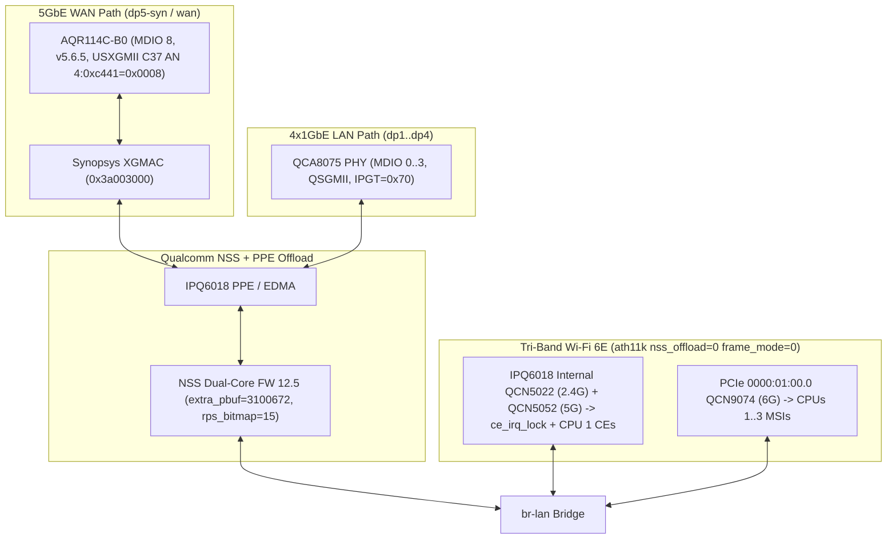

# MR7500 Hardware, Blob, IRQ & Patch Architecture Reference

## 1. Dual-Slot MTD Partition Layout (512 MB Hynix SLC NAND, `erasesize=0x20000`)

| MTD | Offset / Size | Name | Criticality & Current State |
|---|---|---|---|
| `mtd0` | `0x00180000` (1.5 MiB) | `0:SBL1` | Primary Bootloader (Backed up in `pass1..3`) |
| `mtd1` | `0x00100000` (1.0 MiB) | `0:MIBIB` | Partition table / SMEM (Backed up) |
| `mtd2` | `0x00380000` (3.5 MiB) | `0:QSEE` | TrustZone / Secure Execution Environment |
| `mtd3` | `0x00080000` (512 KiB) | `0:DEVCFG` | TZ Device Configuration |
| `mtd4` | `0x00080000` (512 KiB) | `0:RPM` | Resource Power Manager FW |
| `mtd5` | `0x00080000` (512 KiB) | `0:CDT` | Config Data Table |
| `mtd6` | `0x00080000` (512 KiB) | `0:APPSBLENV` | Default U-Boot env |
| `mtd7` | `0x00180000` (1.5 MiB) | `0:APPSBL` | U-Boot (`CBT U-Boot ver: 1.0.12`) |
| `mtd8` | `0x00080000` (512 KiB) | **`0:ART`** | **Factory RF Calibration Data (IRREPLACEABLE — Backed up bit-identical)** |
| `mtd9` | `0x00080000` (512 KiB) | **`0:ETHPHYFW`** | **Marvell AQR114C OEM Flash (`v5.4.B` — bypassed by loading `v5.6.5` from rootfs)** |
| `mtd10` | `0x00080000` (512 KiB) | **`u_env`** | Active U-Boot env (`boot_part=1` or `2`, `boot_part_ready=3`) |
| `mtd11` | `0x00040000` (256 KiB) | **`s_env`** | Linksys boot state counter env |
| `mtd12` | `0x00040000` (256 KiB) | **`devinfo`** | Factory serial, MACs (`hw_mac_addr`), certs (Backed up) |
| `mtd13` | `0x05200000` (82 MiB) | `kernel` | **Slot 1 OpenWrt 6.12.92 + NSS 12.5 FIT Kernel (Nov 20/21 Switch+AP + Patch 0007)** |
| `mtd14` | `0x04a00000` (74 MiB) | `rootfs` | **Slot 1 OpenWrt SquashFS + UBIFS Overlay** |
| `mtd15` | `0x05200000` (82 MiB) | `alt_kernel` | **Slot 2 OpenWrt 6.12.92 + NSS 12.5 FIT Kernel (Active Nov 20/21 Switch+AP + Patch 0007)** |
| `mtd16` | `0x04a00000` (74 MiB) | `alt_rootfs` | **Slot 2 OpenWrt SquashFS + UBIFS Overlay** |
| `mtd17` | `0x00400000` (4 MiB) | `sysdiag` | OEM diagnostics (Backed up) |
| `mtd18` | `0x13d00000` (317 MiB) | `syscfg` | OEM persistent UBIFS config (Backed up in `pass2`/`pass3`) |
| `mtd19` | `0x00500000` (5 MiB) | `app_data` | OEM app data (Backed up in `pass2`/`pass3`) |

*(Original OEM `1.1.12.216943` `alt_kernel`/`alt_rootfs` dumps are preserved in `backups/pass2/` and `backups/pass3/`, plus `vm_archive_87/mr7500/fw/FW_MR7500_1.1.12.216943_prod.img`.)*

---

## 2. System Data-Path & IRQ Architecture Chart

---

## 3. Complete Kernel, DTS, & Overlay Patch Stack (`0001`–`0006`)

1. **`patches/0001-qualcommax-ipq6018-mr7500-add-complete-nss-offload.patch`**
   * Enables NSS 12.5 DTS nodes, AQR114C timing (`reset-deassert-us = <250000>`), USB3 `dr_mode = "host"`, and `0982-net-mdio-fwnode-wait-for-c45-phy-with-reset-gpios.patch` (allows up to 15s for C45 PHY boot after reset).
2. **`patches/0002-qualcommax-ipq6018-mr7500-enable-usxgmii-inband-status.patch`**
   * Adds `managed = "in-band-status";` to `&dp5_syn` for 5G/2.5G/1G/100M USXGMII speed exchange.
3. **`patches/0003-qualcommax-mr7500-fix-usxgmii-probe-race-and-wan-leds.patch`**
   * Adds `0983` (`aquantia` USXGMII AN), `0984` (`device_lock()` serializing `phy_attach_direct` with `probe`), `0985` (`NETREG_REGISTERED` guard in `phy_led_hw_control_set()`), `001-uniphy-usxgmii-autoneg.patch`, and `01_leds` fix (`90000.mdio-1:08:green:wan`, drops unsupported `link_10`).
4. **`patches/0004-qualcommax-mr7500-optimize-pbuf-ipgt-and-cleanup-dts.patch`**
   * Patches `qca-nss-pbuf.init` to allow `512mb`/`auto_scale=1`/`extra_pbuf_core0`/`rps` with `ath11k nss_offload=0`.
   * Adds `002-hppe-gmac-ipgt-0x70.patch` (`qca-ssdk`) setting `GMAC_IPGT_VAL=0x70` for `CPPE_TYPE`.
   * Removes dead `&nss_macsec0` and `blsp1_uart2`, adding `&tlmm bt_reset_hog` (`GPIO 34` `output-low`).
5. **`patches/0005-qualcommax-mr7500-harden-aqr114c-usxgmii-hotplug.patch`**
   * Hardens `aquantia_main.c` (`aqr_wait_fw_provisioning()`, `aqr_enable_usxgmii_autoneg()`, `aqr107_wait_processor_intensive_op()`) across boot, `aqr107_resume()`, `aqr_config_aneg()`, and `aqr107_read_status()` (`4/0xc441=0x0008`).
6. **`patches/0006-qualcommax-mr7500-serialize-ath11k-ahb-ce-irq.patch`**
   * Adds `990-wifi-ath11k-ahb-serialize-ce-irq-enable-disable.patch`: introduces `spinlock_t ce_irq_lock;` in `struct ath11k_ahb` and wraps `CE_HOST_IE_1/2/3` RMWs (`ath11k_ahb_ce_irq_set()`, `ath11k_ahb_modbit32()`) with `spin_lock_irqsave`/`spin_unlock_irqrestore`.
7. **`patches/0007-qualcommax-mr7500-aqr114c-fw-watchdog-and-led-stretch.patch`**
   * Adds `0986-net-phy-aquantia-fw-watchdog-and-led-stretch.patch`: fixes inverted `VEND1_GLOBAL_LED_PROV_ACT_STRETCH GENMASK(1, 0)` + enables 100 ms TX/RX blink stretch (`0x3`), caches/restores LED rules in `aqr_phy_led_restore()`, offloads `aqr_firmware_reload()` to `aqr107_fw_reload_work()` on `system_unbound_wq` monitoring `30:0x0020` & `30:0xc886`, fences concurrent callbacks with `fw_reloading`/`fw_reload_abort`, wires `aqr107_remove()`, adds `cond_resched()` + fast-fail MDIO checks, and bounds retries with exponential backoff (`30s..300s`) and `AQR_FW_RELOAD_MAX_FAILS = 5` (see [aqr114c-watchdog-and-recovery.md](./aqr114c-watchdog-and-recovery.md)).
8. **Overlay Services & Config (`files/` & `config/profiles/`):**
   * `files/etc/uci-defaults/99-mr7500-nss-defaults`: Configures Router Mode defaults (`10.143.1.1/24` unless already applied or Switch+AP mode), `log_size='512'`, `ath11k nss_offload=0 frame_mode=0`, and enables `skb_recycler`, `qca-nss-ecm`, `qca-nss-drv`, `qca-nss-pbuf`, `mr7500-irq-tune`, `mr7500-persist-log`.
   * `files/etc/init.d/mr7500-irq-tune`: Pins `GIC-0 ce[0-9]` onto CPU 1 (`2`); spreads `nss_queue0..3`, `empty_buf_*`, DP IRQs, and QCN9074 PCIe MSIs off CPU 0.
   * `files/etc/init.d/mr7500-persist-log` + `files/usr/sbin/mr7500-log-watch`: Keeps full unbuffered `logread -f -l 9999 -t -F` (`boot-0..3.log`) + 30s health/D-state/dmesg crash snapshots (`boot-0..3.diag`) in `/root/boot-logs/`.
   * `config/profiles/switch-ap/`: Dual-profile override bridging all 5 ports + radios on `192.168.1.91/24` with local DHCP disabled.

---

## 4. Peripheral & Guardrail Notes

* **AQR114C NVMEM Guard:** `mtd9` holds OEM `v5.4.B`. Never add `nvmem-cells = <&aqr_fw>` to `ipq6018-mr7500.dts`.
* **CSR8811 Bluetooth:** Held physically in reset via `&tlmm bt_reset_hog` (`GPIO 34` low) so `/dev/ttyMSM1` stays absent and 2.4 GHz SNR is protected.
* **USB 3.0 & I2C:** `reg_usb_vbus` (`GPIO 25` active-low) powers DWC3 xHCI; `i2c@78b7000` (`GPIO 42/43`, PCA9632 `0x62`) stays disabled in Linux while primary front LEDs use `pwm-leds`.
