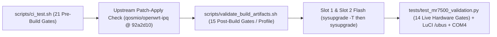

# Linksys MR7500 Validation & CI Test Matrices

## 1. Multi-Tier Verification Flow

---

## 2. Live Hardware 14-Point Regression Matrix (`tests/test_mr7500_validation.py`)

Verified **all hardware gates PASSED** on **both Slot 1 (`boot_part=1`) and Slot 2 (`boot_part=2`)** with the 2026-11-20 Switch+AP build (`sysupgrade.bin` SHA-256 `0740664d8dd3302ea3e1e891f5623c42cb6372ac8b7a5fbab2215d253e19ed54`, live `/lib/modules/6.12.92/aquantia.ko` SHA-256 `79d2eb1bf853b40e6a45f9bccb264a6bc892c4b83b297907a85815661b56b217`), building upon the Nov 15 Wi-Fi/ath11k/LuCI regression baseline (`ath11k_ahb.ko` SHA-256 `1b6d87c321fa18f64ee5e21e5c5e620c624061baae5309c29d6db3f2ef651815`):

| Test ID | Test Case | Verified Switch+AP Result |
|---|---|---|
| **TC-01** | Boot Slot & Dual-Partition Layout | Verified independently on **Slot 1 (`boot_part=1`)** and **Slot 2 (`boot_part=2`)**; alternate slot intact |
| **TC-02** | Kernel Version & CPU Governor | Linux `6.12.92`, 4 Cortex-A53 cores @ `1800 MHz` (`performance`) |
| **TC-03** | Qualcomm NSS Offload & pbuf/RPS | `qca-nss-drv`, `ecm`, `bridge-mgr` active (`extra_pbuf=3100672`, `high_water=30624`, `rps_bitmap=15`, `auto_scale=1`) |
| **TC-04** | AQR114C 5GbE, USXGMII AN, Watchdog & Blink LEDs | `2500 Mb/s Full` (`4:0xc441=0x0008`, `4:0xe812=0xb419`, `FW=0x0506 [fs_only]`, `30:0xc430=0xc06f` 100ms stretch, `30:0xc886` advancing 1 Hz, LEDs `offloaded=1/1`, active RX) |
| **TC-05** | Unified 5-Port Switch Fabric | `lan1`, `lan2`, `lan3`, `lan4`, `phy0-ap0`, `phy1-ap0`, `phy2-ap0`, `wan` bridged in `br-lan` |
| **TC-06** | Management IP & Upstream Gateway | `192.168.1.91/24` (backup IP absent); outbound ping `1.1.1.1` 0% loss |
| **TC-07** | Local DHCP Disabled (AP Mode) | `dhcp.lan.ignore=1`, UDP/67 not listening (no rogue DHCP) |
| **TC-08** | DNS Resolution & IPv6 Reachability | External DNS resolution OK |
| **TC-09** | Tri-Band Wi-Fi 6E & Host Data Path | `Linksys-MR7500-2.4G` (`HE40`), `-5G` (`HE80`), `-6G` (`HE160` OWE); `ath11k nss_offload=0` (`0` RX drops) |
| **TC-10** | USB 3.0 xHCI & VBUS | DWC3 xHCI Host active + `usb-storage` loaded |
| **TC-11** | Thermal Monitoring & Watchdog | All 7 TSENS zones active (~68–69°C); `/dev/watchdog0` ready |
| **TC-12** | CSR8811 Bluetooth Standby | `GPIO 34` held in reset, `/dev/ttyMSM1` absent |
| **TC-13** | NSS Offload & Host CPU Idle | Host CPU ~95–97% idle during active L2/L3 traffic (`944 Mbps` NAT / `2.37 Gbps` 2.5GbE verified in router tests) |
| **TC-14** | NSS & Wi-Fi IRQ Affinity Pinning | All 18 monitored NSS empty-buf and QCN9074 PCIe MSIs off CPU 0; all `GIC-0 ce[0-9]` (`ce0..ce11`) pinned to CPU 1 (`smp_affinity=2`) |

---

## 3. Additional Post-Flash & Stability Checks

* **LuCI `/ubus` Wireless RPC Health (Windows `192.168.1.95` & LAN):**
  * `luci-rpc.getNetworkDevices`, `luci-rpc.getWirelessDevices`, `network.wireless.status`, `iwinfo.devices`, `iwinfo.info` (`phy0-ap0`) all respond in **`0.011s`–`0.089s`** (previously hung `>5s` before Patch `0006`).
* **3-Boot Persistent Crash Logger (`mr7500-persist-log` & `mr7500-log-watch`):**
  * `/sbin/logd -S 512` + `/sbin/logread -f -l 9999 -t -F /root/boot-logs/boot-0.log -S 2048` + 30s health watcher writing `/root/boot-logs/boot-0.diag`.
  * Rotates `boot-0..3.{log,log.old,diag}` once per boot via `/tmp/mr7500-persist-log.booted`.
* **CI Pre-Build Suite (`scripts/ci_test.sh`, `20/20 PASSED`):**
  * Covers `T1-Syntax` (all `.sh`, `init.d/*`, `uci-defaults/*`, `usr/sbin/*`), `T2`–`T3f` (Patches `0001`–`0006`), `T3d-AQRGuard`, `T4-Security`, `T5-Mode`, `T6-Diffconfig`, `T7-BlobExtract`, `T8-Firewall`, `T9-OverlayInit`, `T9b-PersistLog`, `T10-DualProfile`, `T11-TFTPFlasher`, `T12-DocsAndLicenses`, `T13-NoTrackedBinaries`, `T14-PythonAndBuildCLI`.
