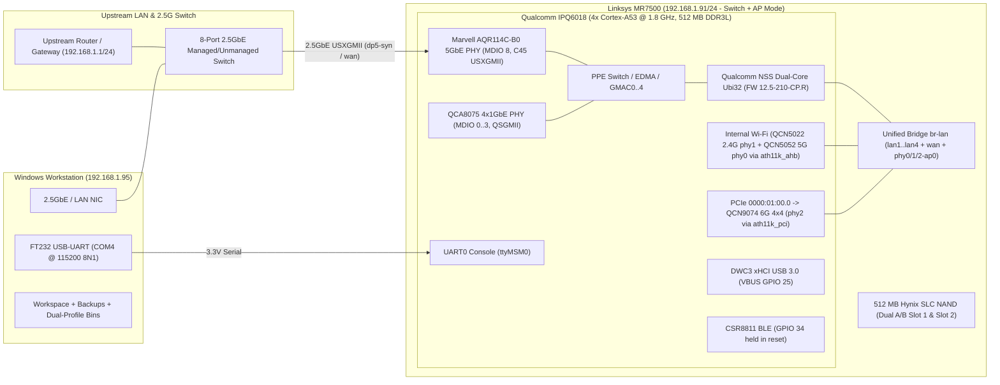
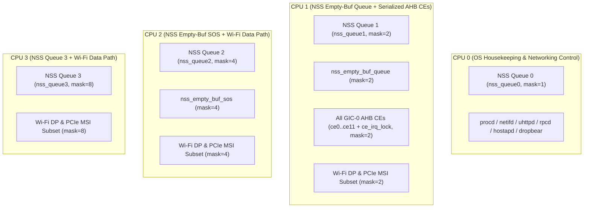
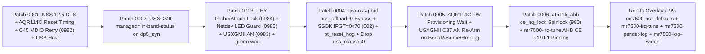
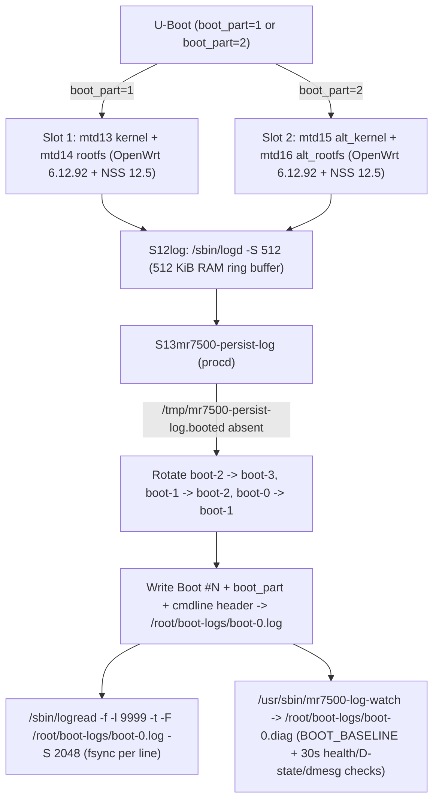

# Linksys MR7500 OpenWrt + NSS Architecture Charts & Engineering Experience Log

This document captures the verified system architecture, hardware/network topology, IRQ affinity layout, patch evolution (`0001`–`0006`), dual-slot boot/logging flow, and empirical lessons learned across development and physical validation on the **Linksys MR7500 (Hydra Pro 6E, IPQ6018, codename `divo`)**.

---

## 1. Hardware & Switch+AP Lab Topology Chart

---

## 2. Quad-Core CPU & IRQ Pinning Architecture Chart

Without explicit IRQ affinity separation and spinlock serialization on shared AHB Copy Engine registers, internal Wi-Fi and NSS control/data paths contend on CPU 0 or lose edge-triggered GIC interrupts.

Key design rules enforced by `patches/0006-qualcommax-mr7500-serialize-ath11k-ahb-ce-irq.patch` and `files/etc/init.d/mr7500-irq-tune`:
* All `GIC-0 ce[0-9]` interrupts are pinned together onto CPU 1 (`smp_affinity=2`) instead of round-robin across CPUs 1–3.
* Inside `ath11k_ahb`, `CE_HOST_IE_1/2/3` register RMWs in `ath11k_ahb_ce_irq_enable()` and `ath11k_ahb_ce_irq_disable()` are serialized by `struct ath11k_ahb::ce_irq_lock` using `spin_lock_irqsave`/`spin_unlock_irqrestore` (never `ab->base_lock`, which uses `_bh` locks and would deadlock in hard IRQ context).

---

## 3. Patch Stack Evolution (`0001`–`0006`) & Overlay Services

---

## 4. Dual A/B NAND Flash & 3-Boot Persistent Logging Flow

---

## 5. Session Engineering Experience Log (Lessons Learned)

### Hardware, Kernel, & Driver Lessons
1. **AQR114C USXGMII C45 Boot & Hotplug Ordering:**
   * A cold-booted `AQR114C-B0` takes ~260 ms after reset deassert (`reset-deassert-us = <250000>`) to answer MDIO address 8 (`0982-net-mdio-fwnode-wait-for-c45-phy-with-reset-gpios.patch`).
   * Even after MDIO probe succeeds, `VEND1_GLOBAL_SYS_CONFIG` / `MDIO_PHYXS_VEND_PROV2` (`4:0xc441`) drops Clause 37 auto-negotiation (`0x0008`) if written before microprocessor provisioning completes or after hotplug/suspend. Patch `0005` enforces `aqr_wait_fw_provisioning()` and re-arms USXGMII AN in `config_init()`, `aqr107_resume()`, `aqr_config_aneg()`, and `aqr107_read_status()`.
   * **Never re-add `nvmem-cells = <&aqr_fw>` to DTS:** `mtd9` (`0:ethphyfw`) retains OEM `v5.4.B` firmware independently of OpenWrt slots. Keeping NVMEM unbound ensures Linux always loads `/lib/firmware/marvell/AQR114C.cld` (`v5.6.5`, SHA-256 `32bc96c2...`).
2. **AQR114C Probe Race & LED Netdev Oops:**
   * `mdiobus_register()` can attach MAC/phylib asynchronously before `aqr107_probe()` finishes provisioning (`0984-net-phy-serialize-attach-with-probe.patch` adds `device_lock()` around attach).
   * `phy_led_hw_control_set()` panics if called before `netdev` finishes registration (`0985-net-phy-led-hw-control-check-registered-netdev.patch` checks `NETREG_REGISTERED`).
   * DTS/board LED name is `90000.mdio-1:08:green:wan` (not `:green:lan`), and `aquantia` does not support `link_10` trigger mode (`-EOPNOTSUPP`).
3. **`ath11k` Host Mode + `qca-nss-pbuf` + `IPGT=0x70`:**
   * With 512 MB RAM and `NSS.FW.12.5`, `ath11k nss_offload=1 frame_mode=2` triggers `qca-nss-wifili` RX descriptor pool starvation (`rx_desc_no_pb`). Setting `ath11k nss_offload=0 frame_mode=0` lets `mac80211` handle Wi-Fi host frames cleanly while `qca-nss-drv` + `ecm` accelerate routed/bridged L2/L3 flows at wire speed.
   * Upstream `qca-nss-pbuf.init` aborted on `nss_offload=0` (`exit 1`), leaving `extra_pbuf_core0=0` and `dev.nss.rps.hash_bitmap=0`. Patch `0004` skips only the Wi-Fi pool allocation so `512mb`, `auto_scale=1`, `extra_pbuf_core0=3100672`, and `rps=15` apply reliably.
   * `qca-ssdk` left PPE GMAC0..3 `IPGT` at `0x60` instead of Linksys OEM's `0x70`; Patch `0004` sets `GMAC_IPGT_VAL=0x70` for `CPPE_TYPE`.
4. **`ath11k_ahb` Copy Engine `ce3` Edge-IRQ Freeze (`-105`/`-ENOBUFS`):**
   * After ~23 hours of uptime, ICMP/SSH/static HTTP remained fast while LuCI `/ubus` wireless RPCs (`getWirelessDevices`, `iwinfo`) timed out (`>5s`) and `rpcd`/`hostapd` hung in `D` state (`ath11k_wmi_cmd_send`, `rtnl_lock`).
   * Root cause: `/proc/interrupts` showed edge-triggered `GIC-0 343 Edge ce3` frozen at `65324` while Q6 remoteproc stayed `running`. `ath11k_ahb_ce_interrupt_handler()` (hard IRQ) and `ath11k_ahb_ce_tasklet()` (softirq) did unlocked RMWs on shared `CE_HOST_IE_1/2/3` registers (`ie1_reg_addr`) across CEs while `mr7500-irq-tune` spread `ce0..ce3` across CPUs 1–3.
   * Fixed by Patch `0006` (`ce_irq_lock` via `spin_lock_irqsave`) + pinning `GIC-0 ce[0-9]` together onto CPU 1 (`smp_affinity=2`).

### OpenWrt Logging, Tooling, & Build Pitfalls
5. **`ubox` `logread` & `logd` Subtle Behaviors:**
   * Running `logread -f` **without** `-l <N>` sends `lines=0` to `logd`, skipping the entire boot ring buffer! Always pass `-l 9999` (`logread -f -l 9999 -t -F <file> -S 2048`).
   * `logread -F <file>` calls `write()` + `fsync()` after **every single line**, preserving all flushed syslog + `kmsg` events up to an unexpected crash/power loss (unlike shell `>>` redirection which libc block-buffers).
   * Running `/sbin/logd -h` interactively while `logd` is running clobbers `/dev/log` socket ownership/inode before printing `unrecognized option: h`! Never invoke `logd -h` on a live router; inspect source or restart `/etc/init.d/log`.
   * Check for `ramoops` in DTS (`dmesg | grep oops` matches `ramoops@50000000` cleanly unless excluded with `grep -v "ramoops@"`). Also note `CONFIG_PSTORE` is disabled in the current `6.12.92` kernel, so hard instantaneous kernel panics still require UART (`COM4`) unless `CONFIG_PSTORE_RAM` is enabled in a future build.
6. **SSH / Paramiko / Dropbear Operational Rules:**
   * OpenWrt Dropbear does not include `sftp-server` (`open_sftp()` fails with `EOFError`); transfer files over `exec_command('cat > /path')` stdin or streaming `tar -cf -` over SSH stdout.
   * Never send literal NUL (`\0`) bytes inside a Paramiko `exec_command` string; Dropbear drops the session with `EOFError`.
   * On Windows, OpenWrt `sysupgrade` images and archives with Linux symlinks should be unpacked with Python `tarfile` skipping/logging `issym()`/`islnk()` rather than failing on symlink privilege (`[WinError 1314]`).
7. **`sysupgrade` Config Preservation:**
   * Custom scripts in `/etc/init.d/` and `/usr/sbin/` not present in the base SquashFS image are NOT preserved across `sysupgrade` unless explicitly listed in `/etc/sysupgrade.conf` (which we configured for `mr7500-persist-log` and `mr7500-log-watch`, in addition to baking them into `Linksys-MR7500-NSS/files/`).
   * Never run `sysupgrade -n` on a configured Switch+AP node unless intentionally wiping configuration; always run `sysupgrade -T /tmp/fw.bin` first.
8. **Infrastructure Migration (2026-11-17):**
   * The `.87` Ubuntu build VM was archived (`vm_archive_87/`) and retired. All source code, Git history (`Linksys-MR7500-NSS/`), Nov 15 dual-profile builds (`bin/router-mode/`, `bin/switch-ap-mode/`), triple-read MTD backups (`backups/pass1..3`), REA outputs (`rea_mr7500_out/`), and VM SSH keys (`.ssh/id_ed25519`) now live in the Windows workspace. Future builds run via GitHub Actions (`.github/workflows/build-monthly-snapshot.yml`) or any Ubuntu 24.04/26.04 host running `scripts/build.sh`.
