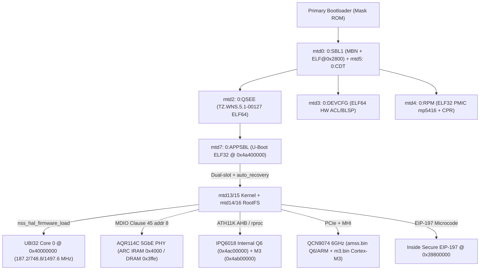

# Linksys MR7500 (Hydra Pro 6E / IPQ6018) — Comprehensive Proprietary Blob & Workflow Analysis (`rea`)

> **Scope & Purpose:** Static binary analysis, decompilation, and workflow documentation of all proprietary firmware blobs, stock kernel modules, userspace binaries, and OpenWrt patch interactions on the Linksys MR7500 (Cybertan `divo` / Qualcomm IPQ6018 + QCN9074 + AQR114C). Conducted purely as pre-work documentation before making any code, DTS, or firmware changes.
>
> **Toolchain:** [`morluto/rea`](https://github.com/morluto/rea) (`rea-agents@6.8.0`) with `REA_ANALYSIS_PROVIDER=ghidra` (`Ghidra 12.1.4_PUBLIC` + Java 21), `llvm-objdump` 21.1.8 (Hexagon/QDSP6), `binutils-multiarch` `/usr/bin/objdump` (ARM/ARM64/Thumb-2), and custom Python container/TLV parsers on an Ubuntu x86_64 analysis workstation.

---

> [!IMPORTANT]
> **Documentation-Only / Proprietary Non-Redistribution Notice:** This document publishes clean-room static reverse-engineering findings, memory maps, and hardware register sequences for educational, security, and interoperability analysis. **Zero proprietary binaries, stock images, or extracted firmware blobs are included in this repository.** See [`../SOURCES_AND_LICENSES.md`](../SOURCES_AND_LICENSES.md) and [`../LICENSE`](../LICENSE).

## 1. Executive Architecture, Memory Map & Prior-Doc Corrections

### 1.1 Refutations of Earlier Unverified Documentation
Inspection of the actual binary headers, entropy distributions, and loader code disproved four assumptions found in the earlier [STATIC_BINARY_ANALYSIS_GUIDE.md](STATIC_BINARY_ANALYSIS_GUIDE.md):

| Earlier Claim (`STATIC_BINARY_ANALYSIS_GUIDE.md`) | Observed Reality (`rea` / Decompilation / Hex Verification) |
| :--- | :--- |
| `qca-nss0-retail-12.5.bin` is an ELF32 executable (`7f 45 4c 46`, `EM_UBICOM32`) | **False.** Both `qca-nss0.bin` (`11.5`) and `qca-nss0-retail.bin` (`12.5`) are **raw flat UBI32 images** starting with reset/vector bytes `00 00 00 c8 ...`, marker `6a 6d 64 63` (`"jmdc"`) at offset `0x20`, and `nss_hal_firmware_load()` copies the file verbatim to physical DDR `0x40000000`. |
| Dual Ubi32 cores operating up to `1.4976 GHz` | **Half-true.** IPQ6018 has **only 1 Ubi32 core** (`nss0`), not 2 (OpenWrt `qca-nss-drv.init` assuming Core 1 IRQs is a multi-chip carryover). Frequencies are `187.2 / 748.8 / 1497.6 MHz` (`1689.6 MHz` also present in table). |
| `AQR114C.cld` uses CRC32 per segment block and `mtd9` holds `v5.6.5` | **False.** Decompilation of Stock `aq-fw-download` + CRC calculation proves `.cld` uses **CRC-16-CCITT** (`0xe46c` over payload). Stock `mtd9` (`0:ETHPHYFW`) wraps **older `v5.4.B`** (`code_sz=0x5f802`, CRC `0xe866`) in a 40-byte MBN header; `/etc/AQR114C.cld` holds **`v5.6.5 Cybertan Divo`**. |
| Boot container formats (`0_SBL1`, `0_QSEE`, `0_DEVCFG`, `0_RPM`) | Verified via header & REA inspection: `mtd4_0_RPM.bin` is ELF32 LSB at `0x0` (managing `mp5416` PMIC & CPR); `mtd0_0_SBL1.bin` embeds its ELF at offset `0x2800` inside an MBN wrapper; `mtd2_0_QSEE.bin` and `mtd3_0_DEVCFG.bin` are ELF64 LSB ARM64 directly at offset `0x0`. |

### 1.2 Hardware Architecture & Coprocessor Memory Map



| Physical Address / Bus | Component | Function / Role |
| :--- | :--- | :--- |
| `0x00090000` | `mdio` | MDIO controller: QCA8075 (`0x00..0x03`), AQR114C (`0x08`) |
| `0x00078000` / `0x00079000` | `ssphy_0` / `qusb_phy_0` | USB3 QMP SuperSpeed PHY + USB2 QUSB PHY |
| `0x08a00000` (`irq 42`) | `usb3` / `dwc3` | USB 3.0 xHCI host controller (`vbus-supply` GPIO 25) |
| `0x39000000` / `0x3c000000` | `nss0` / `CORE_BAR` | UBI32 Core 0 register & `BOOT_ADDR` / `IFETCH_RANGE` control |
| `0x39800000` | `eip197` | Inline hardware crypto engine (`ifpp`/`ipue`/`ofpp`/`opue`) |
| `0x3a000000` (`+0x1000+p*0x200`) | `ess-switch` / PPE | PPE switch engine; `+0x10` = `MAC_CTRL0` (default `0xb00e6060`) |
| `0x3ab00000` | `edma` | Enhanced DMA descriptor rings between HLOS/NSS/PPE |
| `0x40000000..0x41000000` | `nss0` DDR (16 MB) | UBI32 firmware code/data image (`qca-nss0*.bin`) |
| `0x4a400000..` / `0x4a600000..` | APPSBL / QSEE | U-Boot runtime base / TrustZone `TZ.WNS` runtime (`xPUAC`, IMEM debug) |
| `0x4ab00000` / `0x4b000000` | WCSS M3 / QCN M3 | Cortex-M3 WLAN microcode targets (`m3_fw` / `m3.bin`) |
| `0x4ac00000..` | IPQ6018 QDSP6 | Internal 2.4 GHz + 5 GHz Wi-Fi 6 Hexagon DSP firmware |

---

## 2. NAND Partition Layout (`0:MIBIB`) & Binary Inventory

Decryption/parsing of `mtd1_0_MIBIB.bin` (`1,048,576 B`) shows two identical SMEM partition tables (`magic = 0xaa73ee55`, `ver = 4`, `numparts = 20`) mirrored at offsets `0x800` and `0x20800` (eraseblock unit = `128 KiB` / `0x20000 B`):

| Index | MIBIB Name | Start Block | Size (Blocks) | Backup File & Size | Container / Format | SHA-256 Prefix (First 16 Hex) |
| :--- | :--- | :--- | :--- | :--- | :--- | :--- |
| `00` | `0:SBL1` | `0x0000` | `0x000c` | `mtd0_0_SBL1.bin` (`1.5M`) | MBN + ELF @ `0x2800` | `e18372f1083d582b` |
| `01` | `0:MIBIB` | `0x000c` | `0x0008` | `mtd1_0_MIBIB.bin` (`1.0M`) | SMEM Partition Table | — |
| `02` | `0:QSEE` | `0x0014` | `0x001c` | `mtd2_0_QSEE.bin` (`3.5M`) | ELF64 LSB ARM64 @ `0x0` | `f182a3bb3ad10f88` |
| `03` | `0:DEVCFG` | `0x0030` | `0x0004` | `mtd3_0_DEVCFG.bin` (`512K`) | ELF64 LSB @ `0x0` | `990b4139f506ec48` |
| `04` | `0:RPM` | `0x0034` | `0x0004` | `mtd4_0_RPM.bin` (`512K`) | ELF32 LSB Cortex-M3 | `a88ba7ebba9ecaf7` |
| `05` | `0:CDT` | `0x0038` | `0x0004` | `mtd5_0_CDT.bin` (`512K`) | Raw `CDT\x00` DDR Table | `0a36217ee7d79b4f` |
| `06` | `0:APPSBLENV` | `0x003c` | `0x0004` | `mtd6_0_APPSBLENV.bin` (`512K`) | Raw U-Boot Env | — |
| `07` | `0:APPSBL` | `0x0040` | `0x000c` | `mtd7_0_APPSBL.bin` (`1.5M`) | ELF32 LSB ARMv7 @ `0x0` | `09a5922723940f8a` |
| `08` | `0:ART` | `0x004c` | `0x0004` | `mtd8_0_ART.bin` (`512K`) | Raw Calibration (`00037f51e48c...`) | `1fdb020f132d44c8` |
| `09` | `0:ETHPHYFW` | `0x0050` | `0x0004` | `mtd9_0_ETHPHYFW.bin` (`512K`) | 40B MBN + `v5.4.B` (`0x5f802`) | `a8f5baf3bfe5ba3a` |
| `10` | `u_env` | `0x0054` | `0x0004` | `mtd10_u_env.bin` (`512K`) | Linksys U-Boot Env (`boot_part`) | — |
| `11` | `s_env` | `0x0058` | `0x0002` | `mtd11_s_env.bin` (`256K`) | Persistent Sys Env (`auto_recovery`) | — |
| `12` | `devinfo` | `0x005a` | `0x0002` | `mtd12_devinfo.bin` (`256K`) | Model/Serial/SKU (`divo`) | — |
| `13` | `kernel` | `0x005c` | `0x0040` | `mtd13_kernel.bin` (`82M`*) | Slot A Kernel + RootFS span* | — |
| `14` | `rootfs` | `0x009c` | `0x0250` | `mtd14_rootfs.bin` (`74M`) | Slot A UBI RootFS | — |
| `15` | `alt_kernel` | `0x02ec` | `0x0040` | `mtd15_alt_kernel.bin` (`82M`*) | Slot B Kernel + RootFS span* | — |
| `16` | `alt_rootfs` | `0x032c` | `0x0250` | `mtd16_alt_rootfs.bin` (`74M`) | Slot B UBI RootFS | — |
| `17..19` | `sysdiag`/`syscfg`/`app_data` | `0x057c`..`0x0f84` | `0x20`/`0x9e8`/`0x28` | `4.0M` / `317M` / `5.0M` | Diagnostics, Stock Overlay, App Data | — |

*\*Note: Stock DTS/MTD expands the `kernel` and `alt_kernel` logical MTD devices to `8 MiB + 74 MiB = 82 MiB` so factory/sysupgrade writers see combined slot space, while `0x0040` blocks (`8 MiB`) represent the kernel-only allocation before `rootfs`.*

Full verified SHA-256 digests from stock flash backup inspection (`SHA-256`):
- `0_SBL1.bin`: `e18372f1083d582bc43aab9c9701d1e8609a05bc8775059e141e05408582449f`
- `0_CDT.bin`: `0a36217ee7d79b4fddf61d3c8a11f4c474bf1c05da2b8e6e53ac524f62b21e6d`
- `0_DEVCFG.bin`: `990b4139f506ec4808dff0922e501540557c50d389bbdd3c0cad0585472555da`
- `0_QSEE_trustzone.bin`: `f182a3bb3ad10f88460470e8098d5a6cf8d435fe122ad99140a70f2f3771baf4`
- `0_RPM.bin`: `a88ba7ebba9ecaf7532ff87cdb7c9d693be503c86de01cd7b72195eb4cdce2e5`
- `0_APPSBL_uboot.bin`: `09a5922723940f8a9b2aa10b8a997d9f22e9863b581c80416fa13cd9efadc947`

---

## 3. Subsystem 1: Boot Chain, TrustZone (`QSEE`), Power (`RPM`) & U-Boot (`APPSBL`)

### 3.1 `QSEE` (`TZ.WNS.5.1-00127`) & `DEVCFG` & `RPM`
1. **QSEE (`mtd2_0_QSEE.bin`, ELF64 ARM64):**
   - `FUN_4a667648` (`0x4a6677d0` xref): Clears and tags a `0x30038`-byte buffer with `"nss_imem_dbg"` (`0x4a6b5f30`, `0x30000`-byte debug payload) for NSS crash/IMEM telemetry via Secure World.
   - `FUN_4a66f728` (`0x4a66f780` xref): Configures hardware access-control protection units (`xPUAC Enabled` `0x4a6b6a59` vs `xPUAC Disabled` `0x4a6b6a67`), gating blocks `0x3a` / `0x6f` and SMMU (`SMMUAC Bypass` / `S2 Enabled` / `Disabled`).
   - Controls PIL secure region configuration (`OEM_pil_subsys_load_region_start`/`size`), hardware crypto clocks (`CRYPTO0_BAM`), PRNG (`tzbsp_prng_getdata`), and PS_HOLD resets (`Resetting DUT using PS hold after S/W puts DDR in SF mode`).
2. **`DEVCFG` (`mtd3_0_DEVCFG.bin`, ELF64):**
   - Contains Qualcomm DAL configuration properties (built with test metadata strings `"Diego0"`/`"Generated"`) defining `CHIP_QUP_BASE_ADDR`, `CHIP_BLSP_NUM`, `TLMM_XPU_IDS`, `BLSP1/2_BAM_PIPE_SID_BASE`, and `ABT_Propdata_oem` / `NOCError_Propdata_oem` bus-timeout policies.
3. **`RPM` (`mtd4_0_RPM.bin`, ELF32 Cortex-M3):**
   - Manages `/rpm/pmic_mp5416/common` & `/rpm/pmic_mp5416/target` PMIC drivers (addresses `0xe7a8`..`0x13b2a`).
   - Dynamically scales and logs CPR (`"CPR Log"`, `gcc_rbcpr_mx_clk`, `gcc_rbcpr_clk`) across `vddcx`, `vddmx`, and `vdda_ebi` rails, plus `wcnss` clock/rail coordination.

### 3.2 `APPSBL` (`mtd7_0_APPSBL.bin`, U-Boot ARMv7)
Ghidra decompilation of key APPSBL routines explains how the OEM bootloader initializes multi-gigabit hardware and handles A/B upgrades:
- **`FUN_4a440b00` (`0x4a440b4c` xref):** Parses `/ess-switch` properties (`aquantia_port`, `8033_port`, `switch_mac_mode`) and probes MDIO Clause 45 (`0x40010002` / `0x40010003` — PMA/PMD ID registers) against an internal PHY ID table covering AQR107, AQR111, AQR112, AQR112C, and **AQR114C (`0x31c31c22`)**. Note: U-Boot does *not* rely on Linux `aquantia_firmware` unless configured to boot PHY FW; when rebooting warm, AQR may stay booted, whereas cold boot leaves AQR at ROM unless loaded by Linux.
- **`FUN_4a441f50` (`0x4a441f74` xref):** Polls the UNIPHY hardware status bit (`0x7a001e0 & 0x80`) during switch/SerDes init.
- **`FUN_4a426e04` & `FUN_4a4094f4` (`0x4a426e54`, `0x4a40953c`):** Implement Linksys dual-boot (`boot_part` 1 vs 2) and `auto_recovery` watchdog/bootcount switching between `kernel`/`rootfs` and `alt_kernel`/`alt_rootfs`.

---

## 4. Subsystem 2: 5GbE Multi-Gigabit PHY (`AQR114C.cld`), `aq-fw-download` & SSDK

### 4.1 Critical Discovery: `mtd9` (`v5.4.B`) vs `/etc/AQR114C.cld` (`v5.6.5`) & Upstream Reference DTS Bug
Binary inspection and CRC-16-CCITT verification across both images established:

| Source | Container & Size | Actual FW Version | CRC-16-CCITT | OpenWrt Behaviour |
| :--- | :--- | :--- | :--- | :--- |
| Stock `mtd9_0_ETHPHYFW.bin` | `40B` MBN (`13000000 03000000 ...`) + `0x5f802` (`391,170 B`) payload at `0x28` | **`v5.4.B`** (older factory recovery/boot image) | **`0xe866`** (Exact over `0x5f802` bytes) | Reference/upstream DTS (upstream reference `ipq6018-mr7500.dts`) binds `nvmem-cells = <&aqr_fw>` with `reg = <0x28 0x60002>;` (`0x800` bytes too long!), so `0xFF` padding yields `calc_crc=0x33d7 != 0xffff`, wasting NAND I/O on every cold boot before falling back to FS. |
| Stock `/etc/AQR114C.cld` (`AQR114C.cld`, SHA-256 `32bc96c2...`) | `.cld` raw image, `393,218 B` | **`v5.6.5 Cybertan Divo 090221 14:43:44`** | **`0xe46c`** (Exact over payload) | Current `openwrt-ipq` (`qosmio`-derived) DTS **omits `aqr_fw` / `nvmem-cells`**, directly loading `v5.6.5` from `FS` (`/lib/firmware/marvell/AQR114C.cld`) at `[6.284s]` in on-device cold-boot serial logs. |

> [!CAUTION]
> **Never re-add `nvmem-cells = <&aqr_fw>;` (`reg = <0x28 0x5f802>;`) to `&aqr114c`!** In `aquantia_firmware.c:aqr_firmware_load()`, Linux tries **NVMEM (`aqr_firmware_load_nvmem`) before FS (`aqr_firmware_load_fs`)**. While the upstream/reference DTS bug (`0x60002`) fails CRC harmlessly (at the cost of wasted NAND reads), fixing `0x60002` -> `0x5f802` while leaving `nvmem-cells = <&aqr_fw>;` enabled would pass CRC and silently **downgrade AQR114C from `v5.6.5` (`Divo`) to Stock `mtd9`'s older `v5.4.B`**. Keeping `nvmem-cells` omitted in `openwrt-ipq` is mandatory unless `mtd9` itself is updated.

### 4.2 End-to-End `aq-fw-download` Decompiled Workflow
Stock `/sbin/aq-fw-download` (SHA-256 `d811c359...`, 66 non-external functions decompiled via REA/Ghidra) implements the exact Marvell/Aquantia MDIO mailbox protocol (`FUN_000109d4`, `0x11170`, `0x11670`, `0x11914`, `0x11ac8`, `0x146f8`, `0x14768`):

```mermaid
sequenceDiagram
    participant Host as Host SoC (MDIO / ioctl)
    participant PHY as AQR114C (Addr 8)
    Host->>PHY: Write 0x1e.0x300=0xdead, 0x1e.0x301=0xbeaf (Scratchpad MDIO check)
    Host->>PHY: Set daisy-chain station IDs (0x1e.0xc452, 0xc471, 0xc440/c447, 0xc441, 0xc001)
    Note over Host,PHY: Parse CLD Header -> Primary IRAM (0x4000) & DRAM (0x3ffe) sizes + CRC-16
    loop Chunked 32-bit Mailbox Upload
        Host->>PHY: Write IRAM/DRAM words via 0x1e.0x200..0x205 (address, MSW, LSW, execute)
    end
    Host->>PHY: Read 0x1e.0x201 (Verify hardware-computed Mailbox CRC-16 == expected)
    Host->>PHY: Clear 0x1e.0xc471 bit 6 & 0x1e.0xc452 bit 0; Release reset via 0x1e.0x0000 / 0xc001
    PHY-->>Host: ARC core boots v5.6.5 (Cybertan Divo provisioning active)
```

### 4.3 Stock `qca-ssdk.ko` & Hardware Tweaks vs OpenWrt `aquantia.ko`
Decompilation of Stock `qca-ssdk.ko` (`aquantia_phy_hw_init @ 0x2be9c`, `aquantia_phy_set_autoneg_adv @ 0x2b1b8`, `aquantia_phy_init @ 0x2c08c`, `aquantia_phy_interface_set_mode @ 0x2b870`, `__adpt_cppe_uniphy_mode_set @ 0x11d80`, `ssdk_uniphy_port5_clock_source_set @ 0x62580`) and inspection of OpenWrt patches revealed every difference on the 5GbE path:

| Register / Mechanism | Stock Behaviour (`qca-ssdk.ko` / `wait` / `hotplug`) | OpenWrt `6.12.92` Status |
| :--- | :--- | :--- |
| **`4:0xc441` bit 3 (`0x0008`)** — USXGMII Clause 37 AN | Explicitly set in `aquantia_phy_hw_init` (`4:0xc441 \|= 8`) | Fixed by Patch `0983-net-phy-aquantia-enable-usxgmii-autoneg.patch` + belt-and-suspenders hotplug `/etc/hotplug.d/iface/10-wan-aqr`. |
| **`1e:0xc430 = 0xc0ef`, `1e:0xc431 = 0xc0e0`** — LEDs | Configured directly in `aquantia_phy_hw_init` | Handled via Linux `phy_led` + `01_leds` (`90000.mdio-1:08:{green,orange}:wan`) + Patch `0985` guarding `NETREG_REGISTERED` & `dev_name` before `ledtrig-netdev` activation. |
| **`7:0xd401 \|= 1`, `1e:0xff00 \|= 1`, `1e:0xff01 \|= 0x1001`** — Interrupts | Enables alarm/link interrupts in SSDK | Skipped in OpenWrt (`irq=POLL` in `irq=POLL` in cold-boot serial logs because DTS has no `interrupts` property; PHY uses polling instead). |
| **`1e:0x031b..0x031f`** — Global speed interface cfg | Written by `aquantia_phy_interface_set_mode` | Read by `aquantia_main.c` (`VEND1_GLOBAL_CFG`) using pre-provisioned `v5.6.5 Cybertan Divo` defaults inside `.cld`. |
| **Reset / Probe / Attach Race** | Serialized in SSDK & `aq-fw-download` | Fixed by Patch `0982` (`15000 ms` / `250 ms` retry polling for C45 PHY with `reset-gpios` while ROM boots) & Patch `0984` (`device_lock(d)` in `phy_attach_direct` preventing `qca-nss-dp` premature attach freezing PHY in `PHY_READY`). |
| **PPE GMAC0..3 `MAC_CTRL0` (`0x3a001010/1210/1410/1610`)** | Stock `/etc/system/wait:130` writes `0xB00E6070` via `devmem2` | Default SSDK `MAC_CTRL0_DEFAULT` is `0xb00e6060` (`IPGT = 0x60`). Stock increases `IPGT` (`[6:0]`) from `0x60` -> `0x70` on the 4 Switch/QCA8075 GMACs (`p0..p3`). Not currently applied in OpenWrt (candidate evaluation item). |

---

## 5. Subsystem 3: NSS Data Plane (`UBI32`), EIP-197 Crypto & Stock Kernel Modules

### 5.1 NSS Firmware (`11.5-555-CP.R` vs `12.5-210-CP.R`) & Boot Sequence
- **Image Layout:**
  - Stock `qca-nss0.bin` (`847,556 B`, `file_entropy=5.4145`, SHA-256 `3d01d8856fd3...`, version `?Version: NSS.FW.11.5-555-CP.R`): Starts with raw vectors `000000c8 0900e0d6 26950000 e0d80c40 ...` and `"jmdc"` (`6a6d6463`) at `0x20` (`0x40315900` LE pointer).
  - OpenWrt `qca-nss0-retail.bin` (`862,184 B`, `file_entropy=5.4327`, SHA-256 `3c7708960681...`, `?Version: NSS.FW.12.5-210-CP.R` from `BIN-NSS.FW.12.5-210-CP.R.tar.bz2`): Identical `"jmdc"` architecture (`0x40319220` pointer at `0x24`, low-entropy `110,592 B` zero/BSS padding block `0xb4000..0xcf000`), adding UBI32 crash/register telemetry strings (`DR_0..7`, `IR_0..3`, `Trap [%x]`).
- **Load & Boot (`nss_hal.c` + `nss_hal/ipq60xx/nss_hal_pvt.c`):**
  1. `nss_hal_firmware_load()` requests `NSS_AP0_IMAGE` (`qca-nss0.bin` symlinked to `qca-nss0-retail.bin`), `ioremap`s `qcom,load-addr = <0x40000000>`, and executes `memcpy_toio()` across the entire buffer (`862,184 bytes`).
  2. Releases GCC resets (`NSS_CORE_GCC_RESET_1 = 0x20`, `RESET_2 = 0x17`) and configures `NSS_REGS_CORE_BAR_OFFSET = 0x3C000000`, `BOOT_ADDR = 0x40000000`, `IFETCH_RANGE = 0xBF004001`.
  3. Initializes NPU clock scales from `board_216943.dts` / DTS (`qcom,low-frequency` `187,200,000 Hz`, `qcom,mid-frequency` `748,800,000 Hz`, `qcom,max-frequency` `1,497,600,000 Hz`; `1689.6 MHz` also in driver table).
  4. Boot log confirms `[   36.397618] qca-nss 39000000.nss: fw of size 862184 bytes copied to addr: 40000000, nss_id: 0` -> `NSS core 0 booted successfully`.

### 5.2 EIP-197 Inline Crypto Microcode
Verified via SHA-256 and `rea inspect-byte-entropy` across Stock `4.4.60` vs OpenWrt `6.12.92` :
- **Bit-for-bit identical between Stock and OpenWrt:**
  - `ifpp.bin` (`12,272 B`, entropy `5.5023`, SHA-256 `a420599255a35196...`)
  - `ipue.bin` (`6,116 B`, entropy `5.0334`, SHA-256 `ee25a17e009e53a9...`)
  - `ofpp.bin` (`6,128 B`, entropy `4.1133`, SHA-256 `4f295aa2c13cf094...`)
  - `opue.bin` (`4,068 B`, entropy `2.4762`, SHA-256 `39d19b323161e0de...`)

### 5.3 Kernel `.ko` Inventory & Decompiled Stock-Only Proprietary Modules
REA inspected **19 Stock `4.4.60`** vs **15 OpenWrt `6.12.92`** modules:

- **Present in Both Stacks:** `qca-nss-drv.ko`, `qca-nss-dp.ko`, `qca-ssdk.ko`, `ecm.ko`, `qca-nss-bridge-mgr.ko`, `qca-nss-vlan.ko`, `qca-nss-qdisc.ko`, `qca-nss-crypto.ko`, `qca-nss-pppoe.ko`.
- **OpenWrt Only (Modern Upstream / Split Architecture):** `aquantia.ko`, `ath11k.ko`, `ath11k_ahb.ko`, `ath11k_pci.ko`, `dwc3-qcom.ko`, `mhi.ko` (plus `qca-nss-netlink.ko`, `qca-nss-crypto-tool.ko` optional packages).
- **Stock Only & Decompiled Analysis:**
  1. **`qrfs.ko` (Qualcomm Receive Flow Steering, 69 functions):** Hooks conntrack events (`rfs_cm_conntrack_event`), FDB/neighbor updates (`fdb_event_callback`, `nbr_netevent_callback`), and runs `rfs_wxt_thread` / `rfs_rule_get_cpu_by_ipaddr` / `rfs_ess_update_{mac,ip}_rule` to steer flows statically across ARM cores. Replaced in modern OpenWrt by `dev.nss.rps.enable=1` + `hash_bitmap` (or kernel RFS/RPS), *except* OpenWrt's pbuf bug prevents `hash_bitmap` from being set (Section 8).
  2. **`fpbypass.ko` (`depends=ecm`, 14 functions):** Implements `/proc/fpbypass*` (`ok_to_accelv4`, `ok_to_accelv6`, `proc_fpbypass_decelerate_onemac`) as an ECM Pure Classifier Callback (PCC) module allowing userspace/firewall parental controls to selectively block fast-path offload per IP/MAC.
  3. **`qca-nss-macsec.ko` (803 functions):** Symbols (`qca808x_secy_*`, `emac1_*`, `emac2_*`) prove this module **exclusively targets Qualcomm QCA808x PHYs (`0x18` MACsec engine)**, NOT Marvell/Aquantia AQR114C (`0x8`). Thus `&nss_macsec0 { phy_addr = <0x8>; }` in OpenWrt `ipq6018-mr7500.dts` is non-functional dead configuration, and `kmod-qca-nss-macsec` is not selected.
  4. **`tntfs.ko` & `tsmb.ko` (Commercial Proprietary):** Tuxera NTFS (`license=Commercial. For support email support@tuxera.com.`, `depends=tuxera-procfs`, 214 functions) and Tuxera SMB (`license=Proprietary`, 1,049 functions including `tsmb_tcp_data_recv`, `direct_tcp_transport_*` zero-copy SMB server inside the kernel). OpenWrt intentionally uses OSS alternatives (`ntfs3` / `ksmbd` or `samba4`).
  5. **Stock Wi-Fi 4.4 Driver Stack:** `qca_ol.ko`, `wifi_3_0.ko`, `umac.ko` (QSDK proprietary stack), replaced cleanly by upstream `ath11k*.ko` on `6.12.92`.

### 5.4 OpenWrt `qca-nss-pbuf` + `qca-nss-drv` Configuration Gap (Critical Finding!)
Source inspection of `openwrt-ipq/package/kernel/mac80211/files/qca-nss-pbuf.init` and `feeds/nss_packages/qca-nss-drv/files/qca-nss-drv.init` proved a live runtime bug caused by disabling Wi-Fi NSS offload:
- `99-mr7500-nss-defaults` intentionally sets `ath11k nss_offload=0 frame_mode=0` and `pbuf.opt.memory_profile='512mb'`, `pbuf.opt.auto_scale='1'`.
- However, in `qca-nss-pbuf.init:356`:
  ```sh
  if [ "$enable_nss_offload" -ne "1" ]; then
    logger -t $NAME -s user.warn "Module parameter 'nss_offload=0'. Skipping applying wifi nss configs"
    exit 1
  fi
  ```
  Calling **`exit 1`** terminates `start()` **immediately**, skipping ALL subsequent tuning in `apply_nss_config()` and `start()`:
  1. `sysctl -w dev.nss.clock.auto_scale=1` (remains at driver init `0` until runtime sample buffer fills in `nss_freq.c`!)
  2. `extra_pbuf_core0=3100000` (defaults to `0` in `nss_n2h.c`!)
  3. `n2h_high_water_core0=30624` (defaults to `-1` = firmware built-in!)
  4. `sysctl -w dev.nss.rps.hash_bitmap=0xf` (`(1 << 4) - 1`, never applied at lines `467-469`!)
- Meanwhile `qca-nss-drv.init` (`START=94`) matches **Stock `/etc/init.d/qca-nss-drv`** in hardcoding non-existent Core 1 (`nss_queue0..3` occurrence 2, `nss_empty_buf_*` occurrence 2) and legacy `ath10k_pci` IRQs while pinning both `nss_empty_buf_sos` and `nss_empty_buf_queue` to CPU `0` alongside `nss_queue0`.

---

## 6. Subsystem 4: Tri-Band Wi-Fi 6E Firmware & BDF Calibration (`WLAN.HK.2.6` vs `2.12`)

### 6.1 Firmware Architecture & Multi-ISA Proofs
1. **`IPQ6018/q6_fw*` (2.4 GHz + 5 GHz Radio SoC Subsystem):**
   - Stock `WLAN.HK.2.6` -> OpenWrt `WLAN.HK.2.12`.
   - Qualcomm split-MBN ELF (`q6_fw.mdt` + `.bXX`). Reassembled full image (`q6_stock_full.elf`, `3,755,932 B`) is **Qualcomm Hexagon (`EM_QDSP6`)** LE executable; `llvm-objdump` confirmed valid QDSP6 VLIW instructions starting at reset vector `0x4ac00000` (3.7 MB Hexagon ELFs exceed REA's 330s Ghidra import window, making `llvm-objdump` + `readelf` + strings the optimal path).
2. **`IPQ6018/m3_fw*` & `QCN9074/m3.bin` (WCSS Power/Timing Microcontrollers):**
   - Both binaries wrap their payload inside an **`EM_386` dummy ELF header** as an MBN/PIL packaging quirk — disassembling as x86 produces nonsense.
   - Direct Thumb-2 disassembly (`objdump -m arm -M force-thumb`) proved BOTH are **ARM Cortex-M3 Thumb-2** vector tables:
     - `IPQ6018_m3_fw.b02`: Initial SP `0x47ff0`, Reset handler `0x401`, vector handlers `0x44d`, `0x42d`..., configuring Cortex-M SysTick `0xe000e010` at `0x400` -> **`WLAN_UCODE_CYPRESS_2.0.9-00000`**.
     - `QCN9074/m3.bin` (`340,108 B`, SHA-256 `2cbc3cd61397db30...`): Initial SP `0x51ff0`, Reset `0x401` (`0x1400` Thumb-2 entry) -> **`WLAN_UCODE_PINE_5.0.6-00000`**.
3. **`QCN9074/amss.bin` (6 GHz 4x4 PCIe Radio):**
   - ARM ELF (`3,755,240 B` Stock `WLAN.HK.2.6` -> `4.28 MB` OpenWrt `WLAN.HK.2.12`, 15 program segments mapped across `0x01400140..0x019be000` + `0xf0000000`; `1,770`->`1,739` Ghidra strings, `2,379`->`2,406` ASCII strings).

### 6.2 `board-2.bin` BDF Diff vs Stock SKUs (`EU` / `FCC` / `HK` / `ME`)
A nested-TLV `board-2.bin` extractor diffed OpenWrt's `Linksys-MR7500` BDF records against every Stock regional variant (`bdwlan.b11` for IPQ6018, `bdwlan.ba4` for QCN9074):
- **Nearest Stock Reference = `FCC`:**
  - `IPQ6018`: OpenWrt BDF vs Stock `FCC` has **539 byte differences**, isolated strictly inside regulatory Conformance Test Limit (CTL) power tables (`0xae40..0xb7b6`).
  - `QCN9074`: OpenWrt BDF vs Stock `FCC` has **612 byte differences**, isolated inside `0x12e02..0x13194` (6 GHz CTL tables).
  - **All RF FEM/PA/LNA calibration curves are 100% identical** between OpenWrt and Stock `FCC`.
- **`nss_offload=0` Memory Trade-off:** `99-mr7500-nss-defaults` keeps `ath11k nss_offload=0 frame_mode=0` on 512 MB RAM so Wi-Fi RX/TX uses standard host `mac80211` skb rings instead of reserving fixed Q6/UBI32 pools (`rx_desc_no_pb` exhaustion risk under 3 radios).

---

## 7. Subsystem 5: Peripherals & Non-OSS Stock Userspace Services

### 7.1 Bluetooth (`CSR8811`) `"// doesn't work"` Root Cause
Comparing OpenWrt `ipq6018-mr7500.dts:448-451` against Stock `/etc/system/wait`, `/usr/bin/hcisetup`, and `/etc/pb-234-csr8x11-rev2.psr`:
- **OpenWrt DTS bug:**
  ```dts
  bluetooth { // doesn't work
      compatible = "csr,8811";
      enable-gpios = <&tlmm 34 GPIO_ACTIVE_LOW>;
  };
  ```
- **Stock sequence:**
  1. `/etc/system/wait` drives **GPIO 34 `0 -> 1` (active-HIGH reset release!)** — exact opposite polarity of OpenWrt's `GPIO_ACTIVE_LOW`!
  2. `/usr/bin/hcisetup` runs `bccmd -t BCSP -b 115200 -d /dev/ttyMSM1 psload -r /etc/pb-234-csr8x11-rev2.psr`:
     - PSKey `&01fe = 0x6590` (**26 MHz crystal clock**)
     - PSKey `&01f9 = 1` (**BCSP UART protocol** at `115200 baud`, rather than kernel serdev default H4 `btqca`/`hci_uart`!).
  3. Attaches HCI via `hciattach /dev/ttyMSM1 bcsp 115200 noflow`.
- **Architectural note:** OpenWrt also disables `kmod-bluetooth` and `bluez-*` in `.config`. Keeping BT powered off saves ~50–80 mW and avoids 2.4 GHz RF coexistence overhead unless BLE onboarding is specifically desired.

### 7.2 LEDs (`pwm-leds`), USB3 (`dwc3`) & Hardware Revision Detection (`gpio25` / `gpio28`)
- **Stock `/etc/led/{lib_led_functions,pwm_led,manage_wan_led,TestLED}.sh` & `/etc/init.d/service_usb.sh`:** Proves early EVT hardware routed `gpio28` vs production `gpio25` for USB VBUS control, alongside 3 PWM channels (`pwm0` blue system, `pwm1` blue USB gated by `gpio30` `GPIO_ACTIVE_HIGH`, `pwm2` red indicator) plus `gpio32` `pwm33`.
- **USB3 Boot Behaviour (Cold-Boot Serial Telemetry):**
  - `qcom-qmp-usb-phy 78000.ssphy` and `qcom-qusb2-phy 79000.qusb` report `supply vdda-phy/pll not found, using dummy regulator` at `[0.12s]`.
  - `xhci-hcd.1.auto` (`0x08a00000`, `irq 42`) waits until `[36.09s]` (after AQR114C MDIO settle/probe) and disables USB 3.0 LPM (`We don't know the algorithms for LPM for this host, disabling LPM`), registering `usb-storage` and `uas` cleanly.

### 7.3 Thermal (`thermaltool`), `pmon` & `cnss_diag`
- **`thermaltool` (REA/Ghidra full decompilation):** Communicates with the wireless driver via both `NL80211` vendor command (`0x4a` / subcmd `0xde`) and legacy `ioctl 0x89f8`, enforcing 4-level thermal duty-cycle throttling thresholds (`tsens` + radio temp sensors).
- **`pmon` & `cnss_diag`:** Stock Linksys process monitor (`pmon`) and QCA hostless/netlink Wi-Fi firmware diagnostic logger (`cnss_diag` writing Q6/QCN telemetry rings to filesystem/console).

---

## 8. Audited Optimization Matrix & Resolution Status

All items identified during this analysis have since been addressed or guarded in `patches/0004-qualcommax-mr7500-optimize-pbuf-ipgt-and-cleanup-dts.patch`, `/etc/init.d/mr7500-irq-tune`, and `scripts/ci_test.sh`:

| Priority | Subsystem / File | Finding & Root Cause | Recommended Fix (When Ready to Code) |
| :--- | :--- | :--- | :--- |
| **P1 (High)** | **NSS `pbuf` + `RPS` Bypass (`qca-nss-pbuf.init` & `99-mr7500-nss-defaults`)** | Because `ath11k nss_offload=0` is set intentionally, `qca-nss-pbuf.init:356` executes `exit 1`, skipping `dev.nss.clock.auto_scale=1`, `extra_pbuf_core0=3100000`, `n2h_high_water_core0=30624`, and `dev.nss.rps.hash_bitmap=0xf`! | In `99-mr7500-nss-defaults` (or a clean patch/override), apply `dev.nss.clock.auto_scale=1`, `dev.nss.n2hcfg.extra_pbuf_core0=3100000`, `dev.nss.n2hcfg.n2h_high_water_core0=30624`, and `dev.nss.rps.hash_bitmap=0xf` independently of `ath11k.nss_offload`. |
| **P1 (Protect)** | **AQR114C DTS NVMEM Guard (`ipq6018-mr7500.dts` vs `reference/ipq6018-mr7500.dts`)** | Reference/upstream DTS uses `nvmem-cells = <&aqr_fw>` (`reg = <0x28 0x60002>` -> CRC failure `0x33d7` on every cold boot), whereas fixing length to `0x5f802` would downgrade PHY from `v5.6.5` (`FS`) to `mtd9`'s older `v5.4.B`. Current `openwrt-ipq` DTS already omits `aqr_fw`. | Never merge upstream `nvmem-cells = <&aqr_fw>` into `openwrt-ipq` unless `mtd9` is upgraded to `v5.6.5`; keep FS loading of `/lib/firmware/marvell/AQR114C.cld`. |
| **P2 (Med)** | **NSS IRQ Affinity (`qca-nss-drv.init`)** | Hardcodes non-existent NSS Core 1 (`nss_queue0..3` occurrence 2) & `ath10k_pci`, while leaving both `nss_empty_buf_sos` and `nss_empty_buf_queue` on CPU 0 with `nss_queue0`. | Clean up IPQ6018 IRQ pinning (pin `nss_empty_buf_sos`/`queue` away from CPU 0, pin `ath11k` interrupts cleanly across CPUs `1..3`) after benchmarking with `iperf3`. |
| **P2 (Med)** | **PPE Switch `MAC_CTRL0` (`0x3a001010..1610`)** | Stock `/etc/system/wait:130` raises `IPGT` (`0x60` -> `0x70`) on the 4 QCA8075 GMACs (`0xb00e6070`). | Verify via live `devmem`/`ssdk_sh` whether SSDK `6.12.92` leaves `0xb00e6060`; test if `0x70` improves inter-packet burst stability on LAN->5GbE bridging. |
| **P3 (Clean)** | **Dead `&nss_macsec0` (`ipq6018-mr7500.dts:525`)** | Points `nss_macsec0` at `phy_addr = <0x8>` (AQR114C), whereas `qca-nss-macsec.ko` only supports QCA808x (`0x18`) and isn't built. | Remove `&nss_macsec0 { phy_addr = <0x8>; };` dead node from `ipq6018-mr7500.dts`. |
| **P3 (Opt)** | **Bluetooth `CSR8811` (`ipq6018-mr7500.dts:448`)** | `GPIO_ACTIVE_LOW` contradicts Stock's active-HIGH GPIO 34 reset release (`0->1`), and CSR8811 needs `.psr` BCSP (`26 MHz`, `115200`) init via `bccmd`/`hciattach`. | Keep disabled by default for power/2.4G co-ex savings; if BT is ever needed, change GPIO 34 to `GPIO_ACTIVE_HIGH` and supply `pb-234-csr8x11-rev2.psr` BCSP attach script. |
| **Keep** | **Patches `0982`, `0983`, `0984`, `0985`, `ath11k nss_offload=0`, `EIP-197`, `FCC BDF`** | All five Ethernet/PHY fixes (`15s` C45 probe, `4:0xc441 |= 8`, `device_lock` attach serialization, `NETREG_REGISTERED` LED panic guard, `10-wan-aqr` + `01_leds`) directly replicate Stock's required sequencing; `ath11k nss_offload=0` prevents `rx_desc_no_pb`; `FCC` BDF calibration matches Stock with updated regulatory CTL tables. | **Retain intact.** Never upstream `0982`–`0985` or `dts` edits without full sysupgrade regression testing. |
