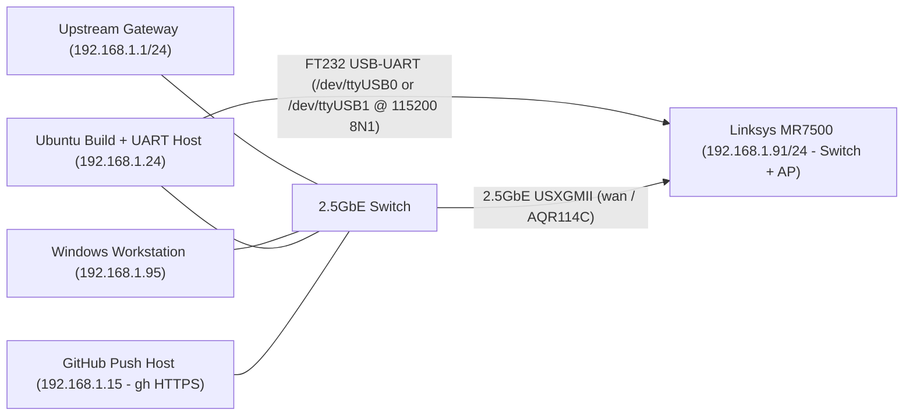

# Linksys MR7500 (Hydra Pro 6E) OpenWrt + NSS Porting Skill

This skill documents the current hardware topology, active dual-slot firmware baseline, Device Tree and kernel patch stack (`0001`–`0008`), triple-read backup verification, 3-boot persistent crash logging, AQR114C runtime firmware watchdog recovery, session lessons learned, and test workflows for the **Linksys MR7500 v1 (codename `divo`)**.

> [!CAUTION]
> ### DISCLAIMER & LIMITATION OF LIABILITY
> **The author(s), contributors, and maintainers of this repository are NOT responsible for any bricked devices, damaged hardware, bootloops, destroyed flash partitions, lost calibration data, data loss, fire, voided warranties, or any other damages or failures resulting from using, compiling, flashing, or modifying the code, device trees, patches, configurations, or instructions provided here.**
> Always maintain verified backups of all MTD partitions (especially `0:ART` and `devinfo`) before flashing. **PROCEED STRICTLY AT YOUR OWN RISK.**

> [!NOTE]
> ### LLM / AI-ASSISTED DEVELOPMENT NOTICE
> This repository's patches, DTS adjustments, reverse engineering analyses, automation scripts, and documentation were developed with AI coding assistants and empirically verified on physical MR7500 hardware via UART telemetry, `phytool`/`ethtool`, `iperf3`, and LuCI `/ubus` regression tests.

---

## 1. Environment & Access Topology (Updated 2026-11-21)

* **Ubuntu Build & UART Host (`192.168.1.24`, `h61`):**
  * **Build Workspace:** `~/mr7500/openwrt-ipq` (`qosmio/openwrt-ipq` `main-nss`) & repo clone `~/Linksys-MR7500-NSS` (branch `master`).
  * **Dual-Profile Outputs:** `~/mr7500/openwrt-ipq/bin/targets/qualcommax/ipq60xx-profiles/{router-mode,switch-ap-mode}/`.
  * **Router UART:** FT232R USB-UART (`115200 8N1`) attached to `192.168.1.24` (`/dev/ttyUSB0`, or `/dev/ttyUSB1` if replugged while an older process holds `/dev/ttyUSB0`).
* **GitHub Push Host (`192.168.1.15`, `ubuntu-gpu-docker`):**
  * Authenticated to GitHub via `gh` HTTPS PAT (`gh auth setup-git`); used to push `~/Linksys-MR7500-NSS` (`origin https://github.com/SanjayRavindran/Linksys-MR7500-NSS.git`) using git bundles transferred from `192.168.1.24`.
* **Windows Workstation (`192.168.1.95`):**
  * Holds project mirror, verified NAND backups (`backups/pass1..3/`, `source_of_truth/`, `critical_and_fallback_bundle.tar.gz`, `live_router_snapshot_20261117/`), stock blobs/extracts (`blobs/`, `stock_extract/`, `stock_nss_11_5_fallback/`), REA analysis (`rea_mr7500_out/`), and retired `.87` VM archive (`vm_archive_87/`).
* **Live MR7500 Router (`192.168.1.91`, Switch + AP Mode):**
  * **Active Dual Slots:** Both **Slot 1 (`boot_part=1`)** and **Slot 2 (`boot_part=2`, currently active)** run the verified **2026-11-26 OpenWrt `6.12.92` + NSS `12.5`** Switch+AP image (`switch-ap-mode` `sysupgrade.bin` SHA-256 `f25e582a68b4eec9622735f7d830c07f720982b77a30d9138990bd6e67edf634`, identical `mtd13`/`mtd15` FIT kernel SHA-256 `c4a7d0f8b2e4e034ce832936978ea3be1ee6495bd5a8d4a2baf2fb05b5594395`, Patches `0001`–`0008`).

---

## 2. Hardware & Firmware Baseline

See [references/hardware-and-dts-audit.md](./hardware-and-dts-audit.md), [references/aqr114c-watchdog-and-recovery.md](../.agents/skills/mr7500-nss-openwrt/references/aqr114c-watchdog-and-recovery.md), and [Architecture & Experience Charts](./ARCHITECTURE_AND_EXPERIENCE_LOG.md).

* **SoC / RAM / Flash:** Qualcomm IPQ6018 (4x ARM Cortex-A53 @ 1.8 GHz, `performance`), 512 MB DDR3L (`386,492 kB` Linux usable, `extra_pbuf_core0=3100672`), 512 MB Hynix `H27S4G8F2EDA-BC` SLC NAND (`erasesize=0x20000`, `0` bad PEBs).
* **5GbE WAN Port (`dp5-syn` / `wan`):** Marvell/Aquantia `AQR114C-B0` (`MDIO 8`, C45 `USXGMII`), loads `/lib/firmware/marvell/AQR114C.cld` (`v5.6.5 Cybertan Divo`, SHA-256 `32bc96c20351d7981d2d905b843899834e6dd620844218d6f3e1ecb9691745f3`). Links at **2500 Mb/s Full** (`4/0xc441=0x0008`, `4/0xe812=0xb419`) across cold boot and hotplug (Patches `0001`–`0005`, `0007`), HW LEDs `offloaded=1/1` with 100 ms blink stretch (`30:0xc430=0xc06f`, `30:0xc431=0xc060`), 1 Hz FW heartbeat `30:0xc886` active linked and unplugged, **2.32/2.37 Gbps** bidirectional TCP verified.
* **Switch Fabric & Switch+AP Bridge:** QCA8075 (`lan1`..`lan4` over `PSGMII` `MAC_MODE_PSGMII=0x00` per Patch `0008`, `IPGT=0x70`, `948.53 Mbps` L2 verified) + `wan` (`dp5-syn`) + `phy0-ap0`/`phy1-ap0`/`phy2-ap0` bridged in `br-lan` (`192.168.1.91/24`, DHCP disabled).
* **Tri-Band Wi-Fi 6E:** `phy1` (`2.4G` `HE40` Ch 6), `phy0` (`5G` `HE80` Ch 36), `phy2` (`6G` `HE160` Ch 37 OWE); host path (`ath11k nss_offload=0 frame_mode=0`) + `ce_irq_lock` (Patch `0006`) + `GIC-0 ce[0-9]` CPU 1 affinity.
* **Peripherals & Logs:** DWC3 xHCI USB 3.0 (`GPIO 25` VBUS), CSR8811 BLE held in reset (`GPIO 34`), 7x TSENS, `/dev/watchdog0`, and 3-boot persistent logger in `/root/boot-logs/` (`boot-0..3.log` + `.diag`).

---

## 3. Patch Stack (`0001`–`0008`) & Rootfs Overlays

| Patch / Service | Summary |
|---|---|
| `0001-qualcommax-ipq6018-mr7500-add-complete-nss-offload.patch` | Complete NSS 12.5 DTS, AQR114C reset timing, USB host, C45 MDIO probe wait (`0982`) |
| `0002-qualcommax-ipq6018-mr7500-enable-usxgmii-inband-status.patch` | Enables USXGMII `managed = "in-band-status"` on `&dp5_syn` |
| `0003-qualcommax-mr7500-fix-usxgmii-probe-race-and-wan-leds.patch` | PHY probe/attach serialization (`0984`), netdev LED Oops guard (`0985`), `0983` USXGMII AN, `green:wan` LEDs |
| `0004-qualcommax-mr7500-optimize-pbuf-ipgt-and-cleanup-dts.patch` | `qca-nss-pbuf` `nss_offload=0` bypass, SSDK `IPGT=0x70` (`002`), `bt_reset_hog`, drops dead `nss_macsec0` |
| `0005-qualcommax-mr7500-harden-aqr114c-usxgmii-hotplug.patch` | `aqr_wait_fw_provisioning()` + `aqr_enable_usxgmii_autoneg()` across boot, resume, `aneg`, and hotplug |
| `0006-qualcommax-mr7500-serialize-ath11k-ahb-ce-irq.patch` | `990-wifi-ath11k-ahb-serialize-ce-irq-enable-disable.patch` (`ce_irq_lock` via `spin_lock_irqsave`) |
| `0007-qualcommax-mr7500-aqr114c-fw-watchdog-and-led-stretch.patch` | `0986`: async `system_unbound_wq` AQR114C FW watchdog (`30:0x0020`/`0xc886`), 100 ms blink stretch (`GENMASK(1, 0)`), LED restore, `cond_resched()` + abort/backoff/5-fail cap |
| `0008-qualcommax-mr7500-use-psgmii-for-qca8075.patch` | Sets `qcom,package-mode`, `dp1..dp4 phy-mode`, and `switch_mac_mode` to `PSGMII` (`0x00`, OpenWrt `#25746` `rx=0` fix) |
| `files/etc/init.d/mr7500-irq-tune` | Pins `GIC-0 ce[0-9]` onto CPU 1 (`2`); spreads `nss_queue0..3`, `empty_buf_*`, DP/PCIe MSIs off CPU 0 |
| `files/etc/init.d/mr7500-persist-log` + `mr7500-log-watch` | Unbuffered `logread -f -l 9999 -t -F` (`fsync` per line) + 30s health/D-state/dmesg crash watcher (3-boot rotation) |

---

## 4. Verification & Test Commands

See [references/test-cases.md](../.agents/skills/mr7500-nss-openwrt/references/test-cases.md) (`22/22` CI gates, `15/15` artifact gates, `14/14` live hardware regression tests).

* **Live Router 14-Point Suite:** `python tests/test_mr7500_validation.py --host 192.168.1.91 --user root`
* **CI Pre-Build Suite:** `bash scripts/ci_test.sh`
* **Inspect Persistent Boot / Crash Logs on Router:** `tail -f /root/boot-logs/current.log`

---

## 5. Critical Session Guardrails (Do Not Regress)

1. **AQR114C NVMEM Guard:** Never re-add `nvmem-cells = <&aqr_fw>` to DTS (`mtd9` holds OEM `v5.4.B`). Notice `T3d-AQRGuard` uses `aqr_fw` so C symbols like `aqr_fw_load_memory` do not false-match.
2. **Never Lock `ab->base_lock` Inside Hard IRQ:** Use dedicated `ce_irq_lock` with `spin_lock_irqsave`; keep `GIC-0 ce[0-9]` pinned on CPU 1.
3. **Never Run `/sbin/logd -h` Live & Always Pass `-l 9999` to `logread -f`.**
4. **C45 `phytool` Syntax:** Use `phytool read wan/8:<mmd>/<reg>` (e.g., `wan/8:0x1e/0x0020`). Without `8:`, `wan/4/...` reads QCA8075 PHY 4.
5. **AQR114C Watchdog Lock Ordering & phylib Guard:** Never hold `phydev->lock` during the ~29s MDIO firmware upload (`ledtrig-netdev` acquires `rtnl_lock` -> `trigger_data->lock` -> `phydev->lock`), never return `< 0` from `aqr107_read_status()` on reload failure (triggers permanent `PHY_ERROR`/`PHY_HALTED`), and never gate reloads on `0x1e/0xc830 BIT(14)`.
6. **Live MDIO Ioctls & UART Pacing:** Keep `wan` UP for `SIOCSMIIREG` ioctls (`phy_do_ioctl_running`). Over UART, never send bytes during U-Boot's autoboot countdown, and pace writes in `<= 48` byte chunks to avoid BLSP UART RX FIFO drops.
7. **Dropbear / Paramiko & Sysupgrade:** Dropbear lacks `sftp-server` and drops on NUL bytes; validate with `sysupgrade -T`, never pass `-n` on configured Switch+AP unless wiping config.
8. **Git / Copyright Hygiene:** Never track `.bin`, `.itb`, `.cld`, `.img`, `.elf`, Ghidra decomp outputs, local Windows `file://` URIs, tokens, or credentials in `Linksys-MR7500-NSS/`.
