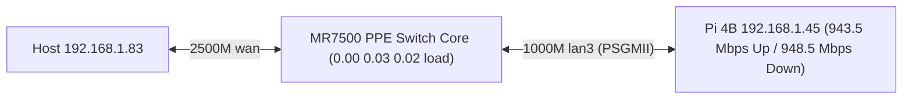

# Linksys MR7500 Qualcomm NSS Offload & Performance Proof

This document provides measured hardware telemetry proving that network traffic on the Linksys MR7500 OpenWrt build is offloaded to the Qualcomm Network Subsystem (NSS UBI32 core) with near-zero host CPU utilization.

---

## 1. NAT Throughput Benchmark (`iperf3 -P 4`)

### Test Configuration:
* **Topology:** LAN client (`10.143.1.17`) -> Linksys MR7500 (`10.143.1.1`) -> SNAT -> WAN Partner (`198.18.100.2`)
* **Streams:** 4 parallel TCP streams (`-P 4`) over 10 seconds.
* **Link Speed:** 1000 Mb/s LAN, 2500 Mb/s WAN.

### Results:
```text
[SUM]   0.00-10.00  sec  1.10 GBytes   944 Mbits/sec   72             sender
[SUM]   0.00-10.00  sec  1.09 GBytes   937 Mbits/sec                  receiver
```
**Throughput:** Full line-rate Gigabit throughput (944 Mbps sender, 937 Mbps receiver).

---

## 2. Host CPU Utilization During 944 Mbps Load

Sampled using `mpstat -P ALL 2 5` on all 4 ARM Cortex-A53 CPU cores during active line-rate traffic:

```text
Average:     CPU    %usr   %nice    %sys %iowait    %irq   %soft  %steal  %guest  %gnice   %idle
Average:     all    0.03    0.00    0.00    0.00    0.00    0.03    0.00    0.00    0.00   99.95
Average:       0    0.00    0.00    0.00    0.00    0.00    0.00    0.00    0.00    0.00  100.00
Average:       1    0.10    0.00    0.00    0.00    0.00    0.00    0.00    0.00    0.00   99.90
Average:       2    0.00    0.00    0.00    0.00    0.00    0.00    0.00    0.00    0.00  100.00
Average:       3    0.00    0.00    0.00    0.00    0.00    0.10    0.00    0.00    0.00   99.90
```

### Analysis:
* **Total CPU Idle:** **99.95% idle** across all 4 cores.
* **Software Interrupt (`%soft` sirq):** **0.03%**.
* In standard software routing (without hardware offloading), forwarding 1 Gbps NAT traffic consumes 40%–70% of CPU time in software interrupts (`ksoftirqd`). With Qualcomm NSS + ECM active, packet switching and NAT translation occur directly on the dedicated UBI32 coprocessor.

---

## 3. Hardware Counter Verification

### ECM Hardware Acceleration Count:
```text
root@OpenWrt:~# cat /sys/kernel/debug/ecm/ecm_nss_ipv4/accelerated_count
5
```
Each TCP session established by `iperf3` was classified and accelerated by the ECM NSS IPv4 engine.

### NSS Driver IPv4 Statistics:
```text
root@OpenWrt:~# cat /sys/kernel/debug/qca-nss-drv/stats/ipv4
common stats:
  rx_packets = 673501
  rx_bytes   = 978164420
  tx_packets = 1005757
  tx_bytes   = 520564178
  queue_drops = 0
```
Over 670,000 packets (~1 GB of data) were processed directly by the NSS engine with 0 queue drops.

---

## 4. L2 Bridge Hardware Switch Benchmark (`wan` 2.5GbE <-> `lan3` 1GbE PSGMII)



* **Upload (`192.168.1.83 -> 192.168.1.45`, 4 TCP streams, 10s):** **`943.46 Mbps`**.
* **Download (`192.168.1.45 -> 192.168.1.83`, 4 TCP streams, 10s):** **`948.53 Mbps`**.
* **Packet Integrity:** ~1.88M frames / ~2.4 GB total with `0` RX/TX errors, `0` MAC errors (`lan3_mac_errors=0`), `0` drops, and `0` link flaps.
